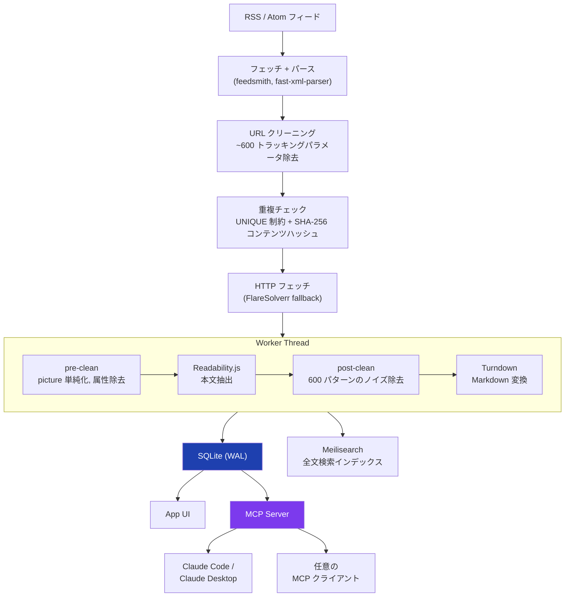

## なぜRSSリーダーか

情報収集は基本活字で、昔からRSSリーダーをよく使ってきた。Google Readerの時代からFeedly、Miniflux、FreshRSSと渡り歩いたし[Pocket](https://getpocket.com/home)のようなRead it later系も使ってきたが落ち着いて使い続けられるサービスがなかった (もっとここがこうだったらな〜とか。サービス自体がなくなることもあった)

そもそも自分がRSSリーダーを使うのは、情報源を自分でコントロールしたいというのが大きい。SNSのアルゴリズムはエンゲージメントに最適化されているため、気づかないうちにフィルターバブルに閉じ込められる。流れてくる情報は「自分が見たいもの」であって「自分が知るべきもの」とは限らない[^my-x-timeline]。RSSリーダーはその対極にある。購読するフィードを自分で選び、アルゴリズムの介在なしに情報が届く。プロアクティブに情報源を設計することで、視野を意図的に広く保てる。

[^my-x-timeline]: 自分のXのタイムラインは動物と車ばかりだが...

RSSリーダに求めることを突き詰めると2つに集約されると思う。

- 面白いブログの新着を追いかけたい
- いろんなサイトを統一したUI（あわよくば自分好みのUI）で読みたい

ただ自分の場合、それに加えてもう少し条件がある。

- 全文をアプリ内で読みたい。元サイトに飛びたくない
- 翻訳・要約。流し読みすることも多いので要旨を摘むには母語に翻訳して読めたほうが嬉しい。「この記事のこれってどういう意味？」とAIに聞きたいこともある
- Dark/Light対応
	- ダークモードに対応してないサイトを夜に見ると目がやられる
	- テーマの配色も自分で選べると嬉しい

既存のリーダーでは特に「全文をアプリ内で読みたい」が満たされない。[Miniflux](https://github.com/miniflux/v2)にはフルテキスト取得機能があるが、フィードごとにopt-inで有効化する必要がある。[FreshRSS](https://github.com/FreshRSS/FreshRSS)はReadabilityアルゴリズム自体を使っておらず、ユーザーが各サイトのCSSセレクタを手動で入力する方式。どちらも設定すればできるのであって最初からそうなっているわけではない。結局、記事タイトルをクリックして元サイトに飛び、Cookieバナーと広告とペイウォールの中で読むことになる。

これらを満たすものがなかったので自分で作ることにした。

## Oksskoltenの機能

こうした背景から[Oksskolten](https://github.com/babarot/oksskolten)[^naming]を作った。デモは [demo.oksskolten.com](https://demo.oksskolten.com/?lang=ja) で触れる。

https://demo.oksskolten.com/?lang=ja

[^naming]: ノルウェー北部の山の名前から取った


主な機能:

- **Inbox、ブックマーク（あとで読む）、いいね、既読履歴による記事管理**
	- いいねやブックマークは記事のengagement scoreに反映される（いいね +10、ブックマーク +5、翻訳済み +3、既読 +2）
	- スコアは時間減衰と掛け合わせて算出され、検索結果のランキングやAIチャットのおすすめに影響する
- **全記事の自動フルテキスト取得**
	- Readability.js と 独自に入れた600パターンのノイズ除去
	- 3フェーズのHTMLクリーニング（pre-clean → Readability → post-clean）
- **AI要約・翻訳・チャット**
	- Anthropic / Gemini / OpenAI
	- Google Translate / DeepL
- **MCPサーバ内蔵**
- **RSSのないサイトのフィード自動生成（LLMによるCSSセレクタ推論）**
	- RSS Auto-discovery → RSS Bridge → LLMセレクタ推論の3段階フォールバック
	- LLMにはページのaタグ構造（5階層分の祖先、class、href、テキスト）を渡し、1行のJSONでCSSセレクタを返させる
- **Meilisearchによるタイポ許容の全文検索**
- **任意URLの記事クリップ**
	- RSSフィードを追いかける必要のない記事を単発で保存する機能
- **記事内画像のローカル/リモートアーカイブ**
- **14テーマ + カスタムJSONテーマ、4レイアウト、10フォント**
- **PWA対応（オフライン閲覧、バックグラウンド同期）**
- **Passkey/WebAuthn + GitHub OAuth認証**

### 自動フルテキスト取得

Oksskoltenは全記事に対して自動的にフルテキスト取得を行う。フィードごとの設定は不要で、RSSを追加した瞬間から全記事がフルテキストで読める。

処理の流れはこう。元記事のURLをHTTPフェッチし、Mozillaの[Readability.js](https://github.com/mozilla/readability)でコンテンツを抽出する。その後、独自の600パターンでノイズ除去（広告、ナビゲーション、サイドバー、トラッカー要素）を行い、[Turndown](https://github.com/mixmark-io/turndown)でMarkdownに変換してSQLiteに保存する。

HTML cleaningは3フェーズで構成されている。Readabilityの前に行うpre-clean（`<picture>`タグの単純化、不要な属性の除去など）、Readabilityによる本文抽出、そしてpost-clean（残留した広告要素やトラッカーの除去）。重要なのはfail-openの設計で、cleanerが例外を投げても元のHTMLにフォールバックする。記事の取り込みがクリーニングのバグで止まるのは良くない。

MinifluxのReadability再実装が約390行であるのに対して、Mozillaの本家Readability.jsは3000行以上ある。スコアリングにおいてもCJK言語の特性を考慮しており、単語数ではなく文字数ベースで計算している。

DOMパース（jsdom + Readability + Turndown）はCPUヘビーな処理だが、[piscina](https://github.com/piscinajs/piscina)で最大2つのWorker Threadに分離しているのでAPIのイベントループはブロックされない。

また、ノイズ除去のパターン設計にはObsidian CEOの[Steph Ango](https://github.com/kepano)が作ってる[defuddle](https://github.com/kepano/defuddle)も参考にした。defuddleはWeb Clipper向けのHTML浄化ライブラリで、広告やナビゲーション要素を取り除くためのセレクタパターンが充実している。

<!---スクショ: 記事詳細画面（フルテキストがMarkdownで表示されている様子）--->

### 適応的なフェッチスケジューリング

フィードの取得間隔は固定ではなく、フィードごとに適応的に調整される。3つのシグナルを組み合わせている。

HTTPレスポンスの`Cache-Control`ヘッダー、RSSの`<ttl>`要素、そして実際の記事更新頻度から算出した経験的な間隔で決める。これらの最大値を取り、15分から4時間の範囲にクランプする。活発なブログは頻繁にチェックし、更新の止まったフィードは自動的にバックオフする。

帯域の最適化も2段階で行っている。まずHTTP 304（ETag/Last-Modified）でサーバー側に変更がないか確認し、レスポンスが返った場合はコンテンツのSHA-256ハッシュを前回と比較する。XMLのパースまで到達するのは実際に内容が変わったときだけ。URLのトラッキングパラメータ（`utm_*`、fbclid、gclid、msclkidなど約600パターン）も事前にストリップすることで、同じ記事が異なるURLで重複登録されるのを防いでいる。

エラー時は5回連続で失敗するとフィードを一時的に無効化する。exponential backoffは`1h × (error_count - 2)`で最大4時間。429/503のレートリミットレスポンスについては`Retry-After`ヘッダーを尊重し、エラーカウントには加算しない。

### RSSがないサイトへの対応

RSSフィードを提供していないサイトも少なくない。Oksskoltenは3段階のフォールバックで対応する。

まずHTMLの`<link rel="alternate">`タグによるRSS Auto-discoveryを試みる。それで見つからなければ[RSS Bridge](https://github.com/RSS-Bridge/rss-bridge)経由でフィードを生成する。それでもカバーできない場合は、サイトのHTMLをLLMに渡して記事一覧のCSSセレクタを推論させ、フィードを自動生成する。RSSフィードを生成するツールは他にもいくつかあるようなのでRSS Bridge以外も使えるようにするかもしれない。

そしてLLMセレクタ推論が独自機能。ページのHTMLから構造化された要素情報（aタグとその5階層分の祖先要素、class属性、href、テキスト）を抽出してLLMに渡す。LLMは1行のJSONでCSSセレクタを返し、それをもとにフィードを組み立てる。推論過程はストリーミングでリアルタイムに確認できる。コストはHaikuで1回あたり$0.001未満でいける。一度セレクタが決まれば以降自動で記事を取得し続けられる。

JSレンダリングが必要なサイトには[FlareSolverr](https://github.com/FlareSolverr/FlareSolverr) (Headless Chrome) で対応している。

<!---スクショ: LLMセレクタ推論のストリーミング画面--->

### 自動既読

Feedlyを使ったことがある人なら「Mark as Read as You Scroll」機能を知っていると思う。記事一覧をスクロールしていくと、通過した記事が自動的に既読になるやつ。Oksskoltenにも同じ機能がある。

実装としてはIntersectionObserverで記事カードの可視状態を検知し、画面内に留まった記事のIDをバッチキューに蓄積してまとめてサーバーに送信する。オフライン時はIndexedDBのキューに退避し、復帰時にバッチで同期する。

デフォルトでは無効で、Settings > Readingからon/offを切り替える。有効にするとマスコットキャラクターが記事一覧に表示されるようになる。マスコットの存在は「いま自動既読が有効ですよ」という視覚的なインジケータを兼ねている。

<!---スクショ: 自動既読のマスコットが表示されている記事一覧--->

### AIチャット

アプリ内にマルチターンのAIチャットを内蔵している。記事詳細画面のフローティングボタンから起動すると、その記事のコンテキスト（タイトル、要約）がシステムプロンプトに含まれた状態で会話が始まる。「この記事の3番目のポイントをもう少し詳しく」「この技術のデメリットは？」のような質問ができる。

チャットは記事単体への質問だけでなく、記事アーカイブ全体を横断した検索や質問にも対応している。「今週のGo関連の記事をまとめて」「最近ブックマークした記事の共通テーマは？」のような使い方。LLMは自然言語のクエリを構造化フィルタ（query、feed_id、日付範囲など）に分解してからMCPツールを呼び出す。


<!---スクショ: 記事詳細画面でチャットが開いている様子--->

### レイアウトとテーマ

4つのレイアウト（list、card、magazine、compact）と14のカラーテーマが用意されている。Default、Claude、Dracula、Nord、Solarized、Tokyo Night、Gruvbox、Rosé Pine、Catppuccin、GitHub などで、それぞれlight/darkの両モードを持つ。コードブロックのシンタックスハイライトもテーマに連動しており、GitHub、Atom One、Tokyo Night、Nord など8種類のハイライトファミリーから選べる。テーマの`highlight`フィールドでデフォルトのハイライトファミリーを指定しつつ、ユーザーが個別に上書きすることもできる。

プリセットの14テーマ以外のテーマを使いたい場合は、JSONで独自テーマを作成してインポートできる。テーマの色定義は`background`、`text`、`accent`、`border`、`hover`など12個の必須トークンと4個の任意トークンで構成されている。任意トークン（`background.sidebar`、`background.card`、`background.header`、`background.input`）を省略するとベースの`background`が自動で適用されるので、実質8色を決めればテーマが作れる。

```json
{
  "name": "my-theme",
  "label": "My Theme",
  "colors": {
    "light": {
      "background": "#ffffff",
      "background.sidebar": "#f0f0f2",
      "background.subtle": "#f5f5f5",
      "background.avatar": "#d8d8dc",
      "text": "#1a1a1a",
      "text.muted": "#6b7280",
      "accent": "#2563eb",
      "accent.text": "#ffffff",
      "error": "#dc2626",
      "border": "#e5e7eb",
      "hover": "rgba(0, 0, 0, 0.04)",
      "overlay": "rgba(0, 0, 0, 0.3)"
    },
    "dark": { ... }
  }
}
```

JSONをSettings > Appearanceからアップロードするかペーストすれば即座に反映される。最大20個まで追加でき、DBに保存されるのでセッションをまたいでも維持される。


### PWA対応

PWAに対応しているのでスマホのホーム画面に追加すればネイティブアプリのように使える。Service Workerによるキャッシュでオフラインでも既読の記事を閲覧できネットワークが不安定な環境でも読めるようにしてある。


## Oksskoltenの設計: リーダーではなくパイプライン

ここからがこのアプリの面白い点。

ここまで機能を列挙してきたが、Oksskoltenの設計を理解するうえで重要なのは個々の機能ではなく、全体のデータフローにある。



上半分がデータ収集層で、下半分がデータ消費層。ポイントは2つある。

1つ目は、パイプラインの出力が単なるSQLiteのテーブルであること。

```sql
SELECT title, full_text, published_at
FROM articles
WHERE feed_id = 42
ORDER BY published_at DESC;
```

RSSフィードのフェッチからReadability抽出、ノイズ除去、Markdown変換を経て、最終的にはSQLiteの`articles`テーブルに行が1つ増えるだけ。全記事がフルテキストでMarkdownとして保存されているので、このテーブルさえあれば何でもできる。

2つ目は、データの消費経路がアプリUIに限定されていないこと。Oksskoltenは[MCP](https://modelcontextprotocol.io/)（Model Context Protocol）サーバを内蔵しており、アプリ内のAIチャットと同じ12個のツール群（`search_articles`、`get_article`、`toggle_bookmark`など）がMCP経由で外部に公開されている。Claude Code、Claude Desktop、あるいは任意のMCPクライアントから記事データにアクセスできる。

つまりOksskoltenの本質はRSSリーダーではなく、RSSフィードを全文取得してSQLiteに溜め続けるデータ収集パイプライン。アプリUIはそのデータを消費する手段の一つにすぎない。

### MCPサーバ

MCPサーバが公開しているツールは現在12個あり以下の通り:

| ツール                                       | 用途                           |
| ----------------------------------------- | ---------------------------- |
| `search_articles`                         | Meilisearchによる全文検索 + 構造化フィルタ |
| `get_article`                             | 記事の全文取得                      |
| `get_similar_articles`                    | 類似記事の検索                      |
| `get_user_preferences`                    | トップフィード、カテゴリ別の既読率            |
| `get_recent_activity`                     | 時系列の既読/いいね/ブックマーク履歴          |
| `get_feeds` / `get_categories`            | フィード・カテゴリ一覧                  |
| `get_reading_stats`                       | 閲覧統計                         |
| `mark_as_read`                            | 既読にする                        |
| `toggle_like` / `toggle_bookmark`         | いいね・ブックマークの切り替え              |
| `summarize_article` / `translate_article` | 要約・翻訳（キャッシュ確認後に実行）           |

アプリを開かなくてもターミナルから以下のように聞ける。

```
> 今週の未読記事で Go に関するものをまとめて
```

LLMは自然言語のクエリを構造化フィルタ（query、feed_id、日付範囲など）に分解してから`search_articles`ツールを呼び出す。


### AI機能の内部構造

AIチャットの内部は4つのバックエンドアダプタ（Anthropic、Gemini、OpenAI、Claude Code）が単一のMCPツール層を共有する設計になっている。ツール定義はプロバイダに依存しないニュートラルな形式で保持し、各アダプタが`toAnthropicTools()`のように変換する。Anthropicアダプタの場合、ツールの呼び出しループは最大10ラウンドまで許容される。Claude Codeアダプタはサブプロセスで実行され、90秒のタイムアウトでSIGKILLする。

要約と翻訳にはAnthropic、Gemini、OpenAIの任意のモデルを指定できる。翻訳についてはLLMに加えてGoogle Translate API v2とDeepLにも対応している。LLMでも翻訳は可能だが、全文翻訳の場合はNMT（Neural Machine Translation）ベースの翻訳サービスに投げた方がレスポンスが速い。LLMはトークン単位の逐次生成なので長文になるほど待ち時間が伸びるが、NMTは文単位で並列処理するため全文が一括で返ってくる。流し読み用途なら翻訳サービスの方が体験が良い。Google Translateは月500K文字、DeepLも月500K文字のFree tierで運用できる。

Google TranslateとDeepLに渡す際は、Markdownをそのまま翻訳APIに投げるとコードブロックやリンク構文が壊れるため、Markdown → HTML（marked）→ 翻訳（format:html指定）→ HTML → Markdown（Turndown）という変換パイプラインを通している。保存した文章をMarkdownで保持しているので翻訳だけ再度HTMLに戻す処理が必要だが、Markdownで持ったほうがメリットが大きいためこうしている。また、RSSフェッチパイプラインと同じTurndown設定を共有しており、翻訳後のMarkdownも一貫したフォーマットになる。


### Claude Codeの `/loop` との組み合わせ

Claude Codeの`/loop`（内蔵cron機能）と組み合わせると、さらに面白い使い方ができる。

```
/loop 30m "Oksskolten の未読記事を確認して、Go・Rust・Zig の
リリースノートやパフォーマンス改善に関する記事があれば
ブックマークして"
```

30分ごとに自動実行され、自分好みの記事が勝手にブックマークされていく。[Feedly](https://feedly.com/)がPro+（$12.99/月）で提供しているAIフィルタリング機能と似たことを、MCP + `/loop`で実現できる。FeedlyのLeo AIはPro+プランに含まれる機能で、翻訳に至ってはEnterprise（$1,600/月〜）でないと使えない。

## 技術選定

### なぜNode.jsか

Node.jsを選んだのは、Readability.jsがそのまま使えるからというのが一番大きい。フルテキスト抽出はこのアプリのコアであり、実績のあるMozillaの本家を使うことにした。

ただReadability.jsには構造的な課題がある。コアのアルゴリズムはArc90（2010年）がベースで、HTML5のセマンティクスを前提としていない。スコアリングでは`<div>`が+5点で最高なのに対し、`<article>`や`<section>`は加点ゼロ、`<main>`に至ってはコード上で一切認識されない。コンテンツの判定はclass名やidに対する正規表現マッチが主体で、`<div class="article-body">`のほうがセマンティックに正しい`<article>`タグより高スコアになる。実際にBBCやWikipedia、MDNなど現代のサイトで本文が途中で切れる・欠落するといった[Issue](https://github.com/mozilla/readability/issues)が継続的に報告されている。

Oksskoltenでは前述の3フェーズクリーニングと独自のコンテンツスコアラーでこれらの弱点を補っているが、Readabilityそのものの限界がありそうといった感じ。将来的にはReadabilityベースでより改善したライブラリを自作して差し替えるかもしれない。

### なぜSQLiteか

そもそもこのアプリはシングルユーザー想定で、同時接続は利用者のひとりだけ。PostgreSQLやMySQLを別コンテナで立てて接続文字列を設定する理由がない。WALモードでread/writeの並行性は確保されるし、バックアップは`cp`一発で済む。データは単一ファイルなのでポータビリティも高い。[libsql](https://github.com/tursodatabase/libsql)経由で[Turso](https://turso.tech/)にも対応しているので、クラウドデプロイにも道がある。

## デプロイ

```bash
git clone https://github.com/babarot/oksskolten.git
cd oksskolten
docker compose up --build
```

初回起動時に[デモ](https://demo.oksskolten.com/?lang=ja)用のシードデータが自動投入される。空のDBで始めたい場合は`NO_SEED=1`を設定する。

自分は自宅のNASで動かしている。最近はOpenClawの影響でMac miniを持っている人も多いと思うが、Mac miniはこういうアプリを動かしておくのにちょうどいいと思う。`docker compose up -d`しておけばあとは勝手に記事を集め続けてくれる。

外部からアクセスしたい場合は[Cloudflare Tunnel](https://developers.cloudflare.com/cloudflare-one/connections/connect-networks/)を使うと簡単に設定できる。Cloudflare側でトンネルを設定するだけで自宅のマシンをHTTPSで安全に公開できる。ポートフォワードもDDNSも固定IPも不要で、自宅のIPアドレスが外部に露出することもない (compose.prod.yamlに`cloudflared`のサイドカーコンテナ含むサンプルコードを置いている)。

## セルフホストの良さと代償

セルフホストの最大の利点は、データが全部自分の手元にあることだと思う。記事の全文、ブックマーク、いいね、チャット履歴、すべてが自宅のSQLiteファイルに入っている。Feedlyが値上げしようがサービスを終了しようが関係ない。自分だけのナレッジDBとして長期間にわたって蓄積し続けられる。

代償は運用が自分であること。Dockerのアップデート、ディスク容量の監視、バックアップ。SaaSに比べればやることは増える。ただSQLiteの単一ファイルなので、バックアップは `cp` か `rsync` で済む。壊れてもOPMLエクスポートがあるのでフィード一覧は復元できる。

OPMLインポート・エクスポートに対応しているので、他のRSSリーダーからの移行も、気に入らなければ別のリーダーへの移行も容易。Miniflux、FreshRSS、Feedlyなど主要なリーダーはすべてOPMLに対応しているので、試してみて合わなければ元のリーダーに戻れる。

## まとめ

OksskoltenはRSSリーダーだが、その本質はフルテキスト記事収集パイプラインだと考えている。データ収集層としてRSSフェッチからReadability + 600パターンのノイズ除去を経てSQLiteに蓄積し、データ消費層としてアプリUIでもClaude Codeでも任意のMCPクライアントでもアクセスできる。読み方を選ばないRSSリーダーになっている。結構いい感じに作れたと思うので興味ある人使ってみてください :-)

https://github.com/babarot/oksskolten
