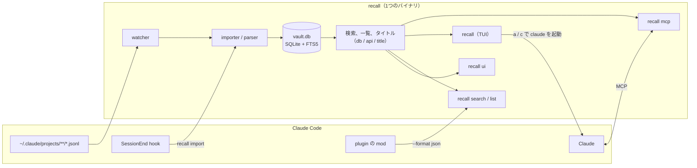

## 過去のClaude Codeとの会話をどう思い出すか

Claude Code を使っていると、「あのとき Claude と何を決めたんだっけ」と思い出したくなることがよくある。

たとえば、ある機能の開発をいくつかのタスクに分け、タスクごとに worktree を切ってセッションを立てて進める。3つ目のタスクの途中で、1つ目のセッションで決めた API のエラーの返し方を確認したくなるが、どのセッションだったかはもう覚えていない。あるいは、障害の調査で Claude と半日かけて原因を突き止めたとする。3ヶ月後に同じような症状が出たとき、あのときどのログを見て、何が原因だったかを思い出したい。

Claude Code の会話は `~/.claude/projects/` の下に JSONL で残っているので、`grep` すれば一応探せる。ただ、1行が1つの JSON で、ツールの呼び出しや結果まで全部入っているので、ヒットしても人が読める形ではない。どのファイルがどのセッションなのかは中を開かないとわからないし、見つけたあとに `claude -r` で戻るにはセッション ID を拾ってくる必要がある。

そもそも、この JSONL は何も設定しなければ30日で消える（`cleanupPeriodDays`）。設定で延ばすことはできるが、延ばしても残るのは読みにくい JSONL の山で、探しにくさは変わらない。残しておくだけでなく、あとから引ける形にしておきたい。

なので、Claude Code のセッションを SQLite に溜めておき、過去の会話を自分も Claude も思い出せるようにするツールを作った。

https://github.com/babarot/claude-recall

もともとは今年の4月に Deno で書いた agent-recall というツールで、10月に Go に書き直して claude-recall に名前を変えた。この記事は、Go に移ってからの1ヶ月弱で作り込んだところの話が中心になる（書き直しの話は最後におまけで書いた）。

## claude-recallでできること

claude-recall は `recall` という1つのバイナリで、過去のセッションへの入り口を4つ持っている。

| やりたいこと | 使うもの |
|---|---|
| Claude に過去のセッションを思い出させる | MCP サーバ |
| 自分で探して、そのセッションに戻る | TUI |
| ブラウザで会話をじっくり読む | Web UI |
| 作業中のセッションを離れずに振り返る | Claude Code の中（plugin） |

どれも同じアーカイブ（`~/.claude/vault.db`）を読む。アーカイブには、Claude Code が JSONL を消したあとのセッションも残る。

入り口は4つあるが、中身は1つの Go のバイナリ `recall` で、取り込みと検索の部分は共有している。全体はこうなっている。



中の作りは、後半の「仕組み」でもう少し詳しく書く。

### Claudeに思い出させる

Claude Code のセッションごとに `recall mcp` が立ち上がり、Claude は必要なときに過去のセッションを検索できる。ツールは4つ。

| ツール | やること |
|---|---|
| `recall_search` | 過去のセッションを全文検索する。`repo` で1つのリポジトリに絞れる |
| `recall_list` | アーカイブにあるセッションを一覧する |
| `recall_export` | セッションの会話を書き出す。`tail` で最後の方だけにもできる |
| `recall_stats` | アーカイブの統計 |

使い方は、普通に Claude に頼むだけ。自分は別のプロジェクトで作業しているときに、こういう頼み方をよくしている。

> 以前ディレクトリ構成をFSDにする、みたいな会話をしてました。recallで検索してみて

Claude は `recall_search` で該当するセッションを見つけ、`recall_export` で中身を読んで答える。過去の文脈は作業中のセッションにそのまま入るので、「じゃあその方針で続きをやって」と続けられる。

ツールのほかに `recap` という MCP の prompt も1つ持っている。セッション ID を渡すと、Claude がそのセッションの終わりの方を読み、やったこと、決めたこと、残っていることをまとめて、どう続けるかを聞いてくる。

### 自分で探して戻る

`recall` を打つと TUI が開く。セッションごとに、タイトル、フォルダ、ブランチ、メッセージ数、サイズ、ID が並ぶ。リポジトリの中で起動すると、そのリポジトリ（worktree も含む）のセッションだけが出る。


主なキーはこう。

- `Enter`: そのセッションのフォルダで `claude -r <id>` を実行して再開する
- `/`: タイトル、フォルダ、ブランチ、ID、会話の中身で絞り込む。`text:`、`title:`、`branch:`、`folder:` などで項目を指定できる
- `Space`: 下のペインに会話を広げて読む。`/` で会話の中を検索できる
- `y`: セッション ID をコピーする。別のエージェントに「このセッションを recall で見て」と渡すのに使う
- `?`: 今いるペインで使えるキーを先頭にして、全部のキーを出す

下のペインには、会話の最初と最後、使ったツールやコマンドの棒グラフ、編集したファイル、日時やサイズなどが出る。どのセッションだったかを見分けるには、タイトルより「何をやったか」の方が役に立つことが多かった。

### 何を打てばいいかわからないときはClaudeに探させる

絞り込みは、覚えている単語があれば速い。ただ「確か Nix のパッケージの話をしていた気がするけど、どのリポジトリだったか」くらいの記憶だと、何を打てばいいかわからない。

`a` を押すと質問の欄が開き、Claude に探させることができる。中では `claude -p` を、recall の検索と一覧のツールだけを許して動かしている。

```console
claude -p <question> --model <ask_model> --no-session-persistence \
  --strict-mcp-config --mcp-config <recall mcp> \
  --tools "" --allowedTools mcp__recall__recall_search,mcp__recall__recall_list
```

自分のログインで動く `claude` を呼ぶだけなので、API キーは要らない（Claude のプランで動く）。探している間は Claude が投げた検索語が順に出て、終わると見つかったセッションとそれぞれを選んだ理由、使ったモデル、かかった時間とコストが出る。そこから1つに飛ぶこともできるし、見つかったセッションだけに一覧を絞ることもできる。

claude-recall は保存にも検索にも LLM を使わないが、ここだけは人間が頼んだときに限って Claude を呼ぶ。自分のアカウントの `claude` を呼ぶので、claude-recall 側で何かを契約したり設定したりする必要はない。

### resumeできないセッションをもう一度思い出す

`claude -r` で戻れないセッションがある。worktree を消したあとのセッションは、フォルダがないので戻れない。Claude Code が transcript を消したセッションも戻れない。worktree を作っては消す使い方をしていると、これがけっこう多い。

そこで `c` を押すと、新しい `claude` を立ち上げ、recall の MCP でそのセッションを思い出させるようにした。最初の欄に「リトライの方針について」のように話題を入れればそこを、空なら「どこまでやったか」を思い出して、指示を待つ。普段 Claude に「recall で〇〇について思い出して」と頼んでいるのと同じことを、TUI から1キーでやる形。

最初はこの操作を continue と呼んでいたが、やっていることは続きをやることではなく、思い出させることなので recall に改めた。使ってみると、`Enter` の resume より `c` の recall の方をよく使う気がしている。

`Y` は再開のコマンドをコピーする。resume できないセッションでは、代わりにこの recall のコマンドをコピーするので、別のターミナルや別の人に渡せる。

### Web UI

`recall ui` で、ブラウザでセッションと会話を読める（`http://localhost:6276`）。TUI は戻れるのが強みで、Web UI は長い会話や画像を読みやすいのが強み、という分担にしている。動かしている間は新しいメッセージが半秒ほどで反映されるので、動いているセッションを横で眺めることもできる。

## Claude Codeの中に描く

ここからが Go に移ってから一番面白かったところ。

claude-recall の plugin には、MCP サーバと `SessionEnd` hook（セッションが終わったら `recall import` する）に加えて、Claude Code の [mod](https://code.claude.com/docs/en/plugins/mods/overview)（hooks module）が入っている。これで Claude Code の画面の中に recall を描いている。

セッションを始めると、同じリポジトリで最近動いたセッションがプロンプトの上に出る。最初のプロンプトを送ると消える。


Claude が `recall_search` を呼ぶと、結果が JSON ではなく、リポジトリ、セッション、ヒットしたメッセージの木として出る。Claude が読むのは今までどおり JSON のまま。


`/recall <query>` は、モデルを通さずにその場で検索して表を出す。Claude も同じ一覧を読んでいるので、そのまま「2番を読んで」と続けられる。どの表示でもセッション ID を押すと、そのセッションで `recap` の prompt が実行される。


## 仕組み

### 取り込みと検索

DB に書き込むのは importer だけで、呼ばれるのは次の3つのとき。

- MCP サーバか Web UI が動いている間、watcher が transcript の変化を見つけたとき
- セッションが終わり、`SessionEnd` hook が `recall import` を実行したとき
- MCP サーバか Web UI が起動したとき（その間に増えた分をまとめて取り込む）

取り込み方はこうなっている。

- 残すもの: ユーザーとアシスタントのテキスト、thinking、ツールの呼び出しと結果、スラッシュコマンドの展開
- 捨てるもの: 進捗、ファイル履歴のスナップショットなどの記録
- 1セッションを1トランザクションで、JSONL の今の中身に丸ごと置き換える
- メッセージは `(session_id, uuid, block_index)` が一意キーなので、何度取り込んでも結果は変わらない

検索は SQLite の FTS5。FTS5 の tokenizer は空白で単語を区切るので、日本語の文は1つのトークンになり、文中の単語では引っかからない。空白のない語で検索されたときは部分一致で探している。

### どの入り口も同じ答えを返す

セッションのタイトルや、どのリポジトリのどの worktree のセッションかは、Go 側の1か所で決めている。TUI、CLI、MCP サーバ、Web UI はどれもそれを通して読むので、TUI に出るタイトルと、Claude が `recall_list` で受け取るタイトルが食い違うことはない。

plugin の mod も同じで、描くだけで判断はしない。mod に必要なものは Go 側で CLI と MCP の JSON に足してから使う。

- 検索結果のリポジトリ、タイトル、サイズ
- 日本語の部分一致
- `recallOnly`: recall の MCP ツールしか呼んでいない、振り返っただけのセッションの印。そういうセッションは同じ語で検索するたびにヒットして、実際に作業したセッションを押しのけるので、mod では1行にまとめる（ID は押せる）

こうしておけば、plugin を入れずに MCP だけで使う人にも、同じ情報が届く。

### 1つのバイナリにまとめる

- SQLite: cgo の要らない modernc.org/sqlite
- TUI: Bubble Tea
- MCP サーバ: 公式の Go SDK
- Web UI: Preact でビルドしたものを `go:embed` で埋め込む

常駐するプロセスはない。MCP サーバは Claude Code が立ち上げ、Web UI は `recall ui` で起動したときだけ動く。

## claude-memとの違い

Claude Code の過去の会話を扱うツールとしては [claude-mem](https://github.com/thedotmack/claude-mem) がよく知られている。同じ問題を扱っているが、claude-recall は claude-mem とは違う方向を選んだ。

claude-mem は、ツールを使うたびに LLM で要約して構造化した事実を作り、ベクトル DB に入れて、次のセッションの開始時にプロンプトへ注入する。エージェントの記憶を延ばすアプローチで、これはこれで筋が通っていると思う。

claude-recall は記憶の層には触らない。Claude Code が書いた JSONL をそのまま SQLite の FTS5 に入れ、人間かエージェントが「前に話した気がする」と気づいたときに引く。

| | claude-mem | claude-recall |
|---|---|---|
| 目的 | エージェントの記憶を延ばす | 人間とエージェントが思い出すのを助ける |
| 文脈の入り方 | push（`SessionStart` で注入） | pull（必要なときに引く） |
| 保存するもの | LLM が要約した observation | 生の会話（ノイズを除いたもの） |
| 検索 | FTS5 とベクトル検索 | FTS5 だけ |
| 常駐 | worker が常駐する | なし |

pull にした理由は、エージェントが「知らない」と言えるようにしたかったから。要約が勝手に注入されると、エージェントは実際には見ていないことを自信を持って覚えている状態になる。要約は原文からずれるし、同じセッションを2回要約すれば違うものができる。生のログならずれないし、検索結果がおかしければ直すのは検索語で済む。ツールで引く形なら、Claude は「わからないので調べます」と言って調べ、読んだものを根拠に答える。

この判断の詳しい経緯は ADR に書いてある。

https://github.com/babarot/claude-recall/blob/main/docs/adr/001-recall-not-memory-extension.md

## 設計の話

### vault.dbをSSoTとして扱う

最初は、SQLite は JSONL から作り直せるキャッシュのつもりだった。ところが Claude Code が古い JSONL を消すので、消えたセッションは `vault.db` にしか残っていない。JSONL が正で DB は派生物、という関係が途中で逆になり、`vault.db` の方が SSoT（Single Source of Truth）になった。作り直そうとして消したら、二度と戻らない。

なので、スキーマの変更は列やテーブルを足すマイグレーションだけにしている（`PRAGMA user_version` で管理）。開発もアーカイブのコピーに対してやる。README でも、バックアップを取ること、作り直すために消さないことを最初に書いている。

```bash
sqlite3 ~/.claude/vault.db ".backup '/path/to/backup.db'"
```

### フッターとキーの一覧を画面の状態から決める

TUI は、ペインやモーダルが増えるたびにフッターのヒントがずれていった。ソートのメニューを足したとき、メニューが開いているのにフッターは一覧のキーを出していた。人間がテストで気づくのは難しいし、Claude に作らせているとなおさら気づかない。

そこで、画面が今どの状態にあるか（どのペインにフォーカスがあるか、どのモーダルが開いているか）を `uiState` という1つの列挙にまとめた。キーの処理、フッター、`?` のキー一覧はすべてこの値を見て決める。テストは全部の状態を回して、フッターがない状態や、キー一覧にグループがないペインがあれば落ちる。新しいペインを足すと、テストに言われて足りないものを埋めることになる。

リポジトリの CLAUDE.md にもこのルールを書いてあるので、Claude に新しいペインを作らせても、同じ手順を踏んでくれる。

キーは設定ファイルの `[keys]` で変えられる。`enter` と `space` を入れ替えたい、というところから始めて、先に設計書を書いてからキーの処理を keymap に寄せた。設定ファイルの書き間違いは、何行目のどこが悪いかを actionlint のように出す。

```toml
[keys]
resume = "space"
read = "enter"
```

## 複数のセッションから1つのDBを使うための工夫

Claude Code はセッションごとに `recall mcp` を1つ立ち上げる。セッションを10個開いていれば、`recall mcp` も10個動いていて、そこに Web UI と `SessionEnd` hook の import も加わる。どれも同じ `vault.db` を読み書きするので、ここが一番気を遣っているところ。

### 書き込みはセッション単位で順番に

書き込む接続は `BEGIN` の時点で書き込みロックを取り、取れなければ最大60秒待つ。複数の import が同時に書き込もうとしても、失敗せずに順番待ちになる。1セッションの取り込みは1つのトランザクションなので、途中まで書かれたセッションや重複した行は残らない。

`recall mcp` と `recall ui` は、起動時の import をバックグラウンドで実行し、すぐに応答する。import に時間がかかっても、Claude Code から MCP サーバが応答しないように見えることはない。あるセッションの import が失敗しても、ほかのセッションの import やサーバは止まらない。

同じセッションを watcher と `SessionEnd` hook が同時に import することもある。先にファイルを読んだ方が後からコミットすると、古い中身で上書きしてしまう。そこで、書き込みロックを取ったあとに、ファイルが読んだときのままかを確かめ、変わっていれば読み直してから書くようにしている。

### 監視するのは1つだけ

watcher は 250ms ごとに transcript のサイズと更新時刻を見て、変わったものを import する。これを全部の `recall mcp` がやると、開いているセッションの数だけ CPU を使ってしまう。

なので、DB の隣にロックファイルを置き、それを持っている1つだけが監視する。ほかは5秒ごとに様子を見て、持っている1つが終わったら引き継ぎ、誰も見ていなかった間に変わったものを先に import する。

持ち主は1秒ごとにロックファイルに触れる。1分触れられていなければ、`claude` を Ctrl-Z で止めたときのように持ち主が止まっているとみなし、待っている1つが次の枠のロックを取って代わりに監視する。Mac のスリープから戻ったときは全員が止まっていたように見えるので、元の持ち主は自分より後の枠が使われていないかも確かめ、使われていれば監視をやめて待つ側に回る。どの状況でも、監視しているのは1つになる。

### WALを64MBに切り詰める

SQLite は WAL ファイルを自分では縮めないので、大きな import を一度すると、WAL がそのサイズのまま残る。WAL をリセットするたびに 64MB まで切り詰めている。

### resumeできるかを確かめてから戻る

TUI の `Enter` は、フォルダがあるかだけでなく、transcript が残っているかも確かめる。Claude Code が transcript を消していれば `claude -r` は失敗するので、フッターの resume に取り消し線を引き、詳細ペインのサイズの横に deleted と出す。`Enter` を押すと、transcript が消えていることと `c` で思い出せることを伝え、`Y` は recall のコマンドをコピーする。


_transcript が消えたセッションで Enter を押したところ_

`cleanupPeriodDays` を大きくしていると気づきにくいが、既定の30日のまま使っていれば、フォルダは残っているのに transcript だけ消えたセッションはすぐに溜まる。

### 読むツリーを増やす

transcript は `~/.claude/projects` だけにあるとは限らない。`CLAUDE_CONFIG_DIR` を設定していればその下を読み、コンテナの中で動かした Claude Code の transcript は、設定ファイルの `extra_projects_dirs` に足したツリーから読む。同じセッションが複数のツリーにあるときは、最後に書かれた方を使う。symlink のプロジェクトディレクトリや transcript もたどり、同じファイルを2回読まないようにしている。

## おまけ: DenoからGoに書き直した

agent-recall は Deno と TypeScript で書いていた。当時の候補はシェルスクリプトか Rust で、Deno なら JSONL のパース、組み込みの SQLite、`deno compile` での単一バイナリがすぐ揃ったから。そのときは TUI は要件になかった。

次に欲しくなったのが TUI で、Go の Bubble Tea で書くのが自然だった。TUI だけ Go にすると2つの言語を配ることになるので、全部 Go に書き直した。

気にしたのは、既存の `vault.db` をそのまま読み書きできること。消えたセッションが入っているので、書き直しのついでに作り直すことはできない。TypeScript 版と同じ行を保存するために、JavaScript の `trim`、UTF-16 での文字数、`JSON.stringify` のキーの順番と数値の書き方を再現するパッケージ（`internal/jscompat`）を作った。これがないと、再 import のたびに保存済みのテキストが書き換わってしまう。

切り替える前に、実アーカイブのスナップショット（1040セッション、約24万メッセージ）で両方の実装を比べ、DB の全行、CLI の出力、MCP のツール、HTTP のエンドポイントがバイト単位で一致するのを確かめた。

書き直しでついでに良くなったこともある。

- 全件の import が 67秒から31秒になった
- TypeScript 版は同時に import すると画像の行が重複していた（手元で854件）。セッションごとに1つのトランザクションで import するようにして、重複しなくなった
- watcher を fsnotify からポーリングにした。macOS の kqueue は transcript ごとにファイルディスクリプタを開く必要があり、ディレクトリを再帰的に監視できない
- Web サーバを 127.0.0.1 だけで待ち受けるようにした。それまでは全インターフェースで待ち受け、`/api/file` は絶対パスで任意のファイルを返していた

書き直した日に 1.0.0 を出し、この記事を書いている時点で v1.8.2 になっている。`recall update` で最新版に入れ替えられるようにし、TUI では `w` でリリースノートを読める。

## まとめ

claude-recall は、Claude Code のセッションを消える前に SQLite に残し、Claude からも自分からも引けるようにするツール。記憶を延ばすのではなく、「前に話した気がする」と気づいたときに思い出せるようにする、というところに絞っている。

作ってみて一番よかったのは、プロジェクトをまたいで「recall で探して」と頼めるようになったこと。前のセッションで何を決めたかを自分で探して貼り付ける必要がなくなったし、worktree を消したあとのセッションにも `c` で戻れる。Claude Code を毎日使っている人はぜひ試してみてください :-)

```bash
curl -fsSL https://raw.githubusercontent.com/babarot/claude-recall/main/bin/install.sh | bash
# または
nix profile install github:babarot/nur-packages#claude-recall
```

https://github.com/babarot/claude-recall

