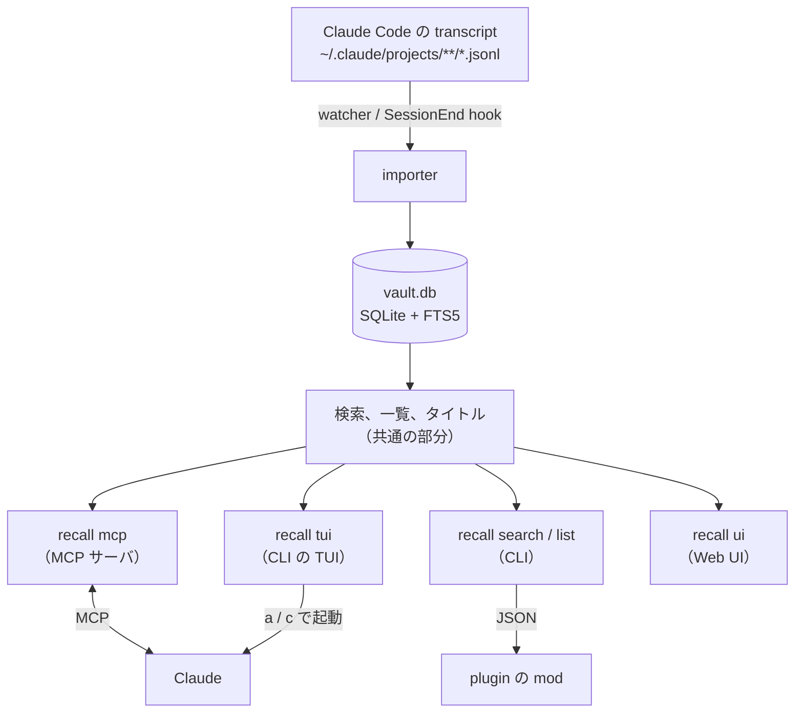
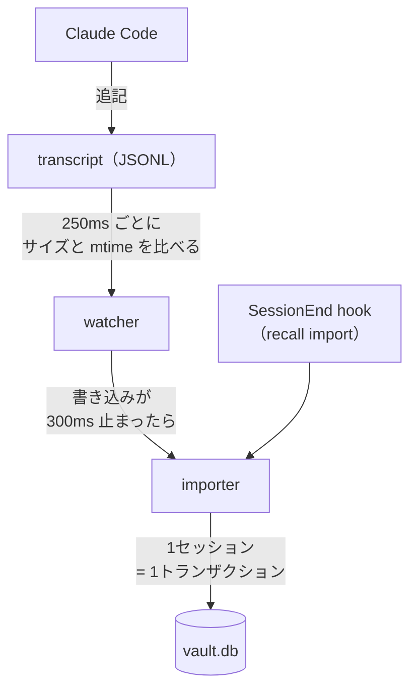
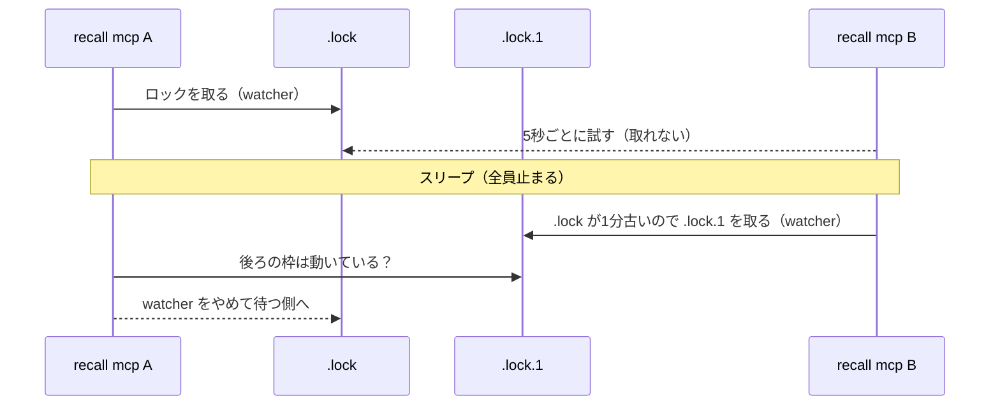

## 過去のClaude Codeとの会話をどう思い出すか

Claude Code を使っていると、「あのとき Claude と何を決めたんだっけ」と思い出したくなることがよくある。

たとえば、

- 前のセッションで設計を相談して、2つの案のうち片方に決めた。コードには決めた方しか残っていないので、もう片方をなぜやめたのかを思い出したい
- 障害の調査で、Claude とログやクエリを見ながら原因を突き止めた。似た症状がまた出たので、そのときどこを見て、何を試して、何が外れだったかを知りたい
- 別のセッションで、今の作業にも関わる方針を話していた。そのセッションに戻らずに、今のセッションの Claude にその話を踏まえてほしい

みたいなとき。どれも、コードや `git log` には残らず、会話の中にしかないこと。

Claude Code の会話は `~/.claude/projects/` の下に JSONL で残っているので、`grep` すれば一応探せる。ただ、1行が1つの JSON で、ツールの呼び出しや結果まで全部入っているので、ヒットしても人が読める形ではない。どのファイルがどのセッションなのかは中を開かないとわからないし、見つけたあとに `claude -r` で戻るにはセッション ID を拾ってくる必要がある。

そもそも、この JSONL は何も設定しなければ30日で消える（`cleanupPeriodDays`）。設定で延ばすことはできるが、延ばしても残るのは読みにくい JSONL の山で、探しにくさは変わらない。残しておくだけでなく、あとから引ける形にしておきたい。

なので、Claude Code のセッションを SQLite に溜めておき、過去の会話を自分も Claude も思い出せるようにするツールを作った。

https://github.com/babarot/claude-recall

もともとは今年の4月に Deno で書いた agent-recall というツールで、10月に Go に書き直して claude-recall に名前を変えた。この記事は、Go に移ってからの1ヶ月弱で作り込んだところの話が中心になる（書き直しの話は最後におまけで書いた）。

## claude-recallでできること

claude-recall は `recall` という1つのバイナリで、過去のセッションへの入り口を4つ持っている。

| やりたいこと | 使うもの |
|---|---|
| Claude に過去のセッションを思い出させる | MCP サーバ |
| 自分で探して、そのセッションに戻る | CLI（TUI） |
| ブラウザで会話をじっくり読む | Web UI |
| 作業中のセッションを離れずに振り返る | Claude Code の中（plugin） |

どれも同じアーカイブ（`~/.claude/vault.db`）を読む。アーカイブには、Claude Code が JSONL を消したあとのセッションも残る。

入り口は4つあるが、中身は1つの Go のバイナリ `recall` で、取り込みと検索の部分は共有している。全体はこうなっている。



中の作りは、後半の「仕組み」でもう少し詳しく書く。

### Claudeに思い出させる

Claude Code のセッションごとに `recall mcp` が立ち上がり、Claude は必要なときに過去のセッションを検索できる。ツールは4つ。

| ツール | やること |
|---|---|
| `recall_search` | 過去のセッションを全文検索する。`repo` で1つのリポジトリに絞れる |
| `recall_list` | アーカイブにあるセッションを一覧する |
| `recall_export` | セッションの会話を書き出す。`tail` で最後の方だけにもできる |
| `recall_stats` | アーカイブの統計 |

使い方は、普通に Claude に頼むだけ。冒頭の例なら、こう頼む。

> 前に API のエラーレスポンスの形を決めたセッションがあったはず。recall で探して、何を決めたか教えて

Claude は `recall_search` で該当するセッションを見つけ、`recall_export` で中身を読んで答える。過去の文脈は作業中のセッションにそのまま入るので、「じゃあその方針で続きをやって」と続けられる。

ツールのほかに `recap` という MCP の prompt も1つ持っている。セッション ID を渡すと、Claude がそのセッションの終わりの方を読み、やったこと、決めたこと、残っていることをまとめて、どう続けるかを聞いてくる。

### 自分で探して戻る

`recall`（または `recall tui`）を打つと TUI が開く。セッションごとに、タイトル、フォルダ、ブランチ、メッセージ数、サイズ、ID が並ぶ。リポジトリの中で起動すると、そのリポジトリ（worktree も含む）のセッションだけが出る。


主なキー:

- `Enter`: そのセッションのフォルダで `claude -r <id>` を実行して再開する
- `/`: タイトル、フォルダ、ブランチ、ID、会話の中身で絞り込む。`text:`、`title:`、`branch:`、`folder:` などで項目を指定できる
- `Space`: 下のペインに会話を広げて読む。`/` で会話の中を検索できる
- `y`: セッション ID をコピーする。別のエージェントに「このセッションを recall で見て」と渡すのに使う
- `?`: 使えるキーのヘルプ

### TUIからClaudeに探させる

MCP で Claude がやっている検索を、TUI の中からも頼めるようにしている。絞り込みは覚えている単語があれば速いが、「確か Nix のパッケージの話をしていた気がする」くらいの記憶だと、何を打てばいいかわからない。そういうときに `a` を押して質問を書くと、Claude が recall で探して、見つけたセッションを TUI の一覧に返す。

中では `claude -p` を、recall の検索と一覧のツールだけを許して動かしている。

```console
claude -p <question> --model <ask_model> --no-session-persistence \
  --strict-mcp-config --mcp-config <recall mcp> \
  --tools "" --allowedTools mcp__recall__recall_search,mcp__recall__recall_list
```

自分のログインで動く `claude` を呼ぶので、API キーも claude-recall 側の設定も要らない。答えには見つかったセッションとそれを選んだ理由が並び、そこから1つに飛ぶことも、見つかったセッションだけに一覧を絞ることもできる。claude-recall が LLM を呼ぶのは、ここで人間が頼んだときだけ。

### resumeできないセッションを再開する

`claude -r` で戻れないセッションがある。worktree を消したあとのセッションは、フォルダがないので戻れない。Claude Code が transcript を消したセッションも戻れない。worktree を作っては消す使い方をしていると、これがけっこう多い。

そこで `c` を押すと、新しい `claude` を立ち上げ、recall の MCP でそのセッションを擬似的に再開できるようにしている。最初の欄に「リトライの方針について」のように話題を入れればそこを、空なら「どこまでやったか」を思い出して、指示を待つ。普段 Claude に「recall で〇〇について思い出して」と頼んでいるのと同じことを、TUI から1キーでやる形。

TUI は、フォルダがあるかだけでなく、transcript が残っているかも確かめている。消えていれば、フッターの resume に取り消し線を引き、詳細ペインのサイズの横に deleted と出す。`Enter` を押すと、transcript が消えていることと `c` で再開できることを伝える。


_transcript が消えたセッションで Enter を押したところ_

### Web UI

`recall ui` で、ブラウザでセッションと会話を読める（`http://localhost:6276`）。TUI は戻れるのが強みで、Web UI は長い会話や画像を読みやすいのが強み、という分担にしている。動かしている間は新しいメッセージが半秒ほどで反映されるので、動いているセッションを横で眺めることもできる。


_会話を読むところ。ツールの呼び出しは畳まれ、右に自分の発言が並ぶ_


_セッションの「やったこと」。使ったツール、走らせたコマンド、編集したファイルがまとまる_

## Claude Code Modsとの連携

Claude Code には、plugin から Claude Code の画面に描画したり、スラッシュコマンドを足したりできる mod（hooks module）という仕組みがある。まだ新しい機能で、詳しくは公式のリファレンスにある。

https://code.claude.com/docs/en/plugins/mods/overview

claude-recall の plugin には、MCP サーバと `SessionEnd` hook（セッションが終わったら `recall import` する）に加えて、この mod が入っていて、Claude Code の画面の中に recall を出している。

セッションを始めると、そのリポジトリで最近動いたセッションがプロンプトの上に並ぶ。昨日の続きをやりたいなら、ID を押せば Claude が前回どこまでやったかを読み、すぐに続きから始められる。再開しないときも、前に何をやっていたかをちらっと確認できる。一覧は最初のプロンプトを送ると自動で消える。


Claude に過去のセッションを探させると、検索結果がリポジトリごとにツリー表示され、各セッションの下にヒットしたメッセージが並ぶ。JSON の塊を読まなくても、Claude が見当違いのセッションを拾っていないかをその場で確かめられる。Claude が受け取るのは今までどおり JSON なので、答えの中身は変わらない。


自分で探したいときは `/recall <query>` を使う。モデルを通さずにその場で検索して表を出すので、トークンを使わず、待たされることもない。Claude も同じ一覧を受け取っているので、表を見て「2番を読んで」と頼めばそのまま続けられる。気になるセッションがあれば ID を押すだけで、Claude がそのセッションでやったこと、決めたこと、残っていることをまとめ、どう続けるかを聞いてくる（`recap` の prompt）。


## 仕組み

冒頭の図のうち、取り込みと MCP サーバのまわりをもう少し詳しく書く。

### watcherとimporter

transcript の変化は watcher が見つけ、importer が DB に取り込む。



watcher は fsnotify を使わず、ポーリングしている。macOS の fsnotify（kqueue）は transcript ごとにファイルディスクリプタを開く必要があり、ディレクトリを再帰的に監視できない。サイズと mtime を見るだけなら、transcript が1000個あっても1回の走査は数ミリ秒で済む。変化を見つけても、書き込みが 300ms 止まるまで待ってから取り込むので、Claude が続けて書いても import は1回にまとまる。

importer は次のように取り込む。

- 前回取り込んだときと mtime が同じファイルは読まない
- 残すもの: ユーザーとアシスタントのテキスト、thinking、ツールの呼び出しと結果、スラッシュコマンドの展開
- 捨てるもの: 進捗、ファイル履歴のスナップショットなどの記録
- 1セッションを1トランザクションで、JSONL の今の中身に丸ごと置き換える
- メッセージは `(session_id, uuid, block_index)` が一意キーなので、何度取り込んでも結果は変わらない

同じ DB に書き込むプロセスは複数ある。書き込む接続は `BEGIN IMMEDIATE` で最初に書き込みロックを取り、`busy_timeout` で最大60秒待つので、同時に import しても失敗せずに順番待ちになる。watcher と `SessionEnd` hook が同じセッションを同時に取り込むこともあるので、ロックを取ったあとにファイルが読んだときのままかを確かめ、変わっていれば読み直してから書く。先に読んだ方が後からコミットして、古い中身で上書きすることはない。

SQLite は WAL ファイルを自分では縮めないので、`journal_size_limit` でリセットのたびに 64MB まで切り詰めている。

### 誰がwatcherになるか

Claude Code はセッションごとに `recall mcp` を1つ立ち上げる。セッションを10個開いていれば `recall mcp` も10個動いていて、全部が watcher を回すと、同じ変更を10回取り込み、CPU もセッションの数だけ使う。なので、watcher になるのは1つだけにしている。いわゆるリーダー選出（leader election）で、DB の隣のロックファイル（`vault.db.watch-<hash>.lock`）で決める。Kubernetes の Lease と同じく、持ち主が定期的に更新し、一定時間更新されなければ失効したとみなす形にしている。

- `flock(LOCK_EX|LOCK_NB)` でロックを取れた1つが watcher になる。ロックはプロセスが終われば OS が外すので、落ちても残らない
- ほかは5秒ごとにロックを取りにいき、取れたら watcher を引き継ぐ。引き継いだときは、誰も見ていなかった間に変わったものを先にまとめて取り込む
- watcher は1秒ごとにロックファイルの mtime を更新する
- ロックが取られたまま mtime が1分止まっていたら、持ち主は止まっているとみなす（`claude` を Ctrl-Z で止めると、その `recall mcp` も止まる）。待っている1つが次の枠（`.lock.1`）のロックを取って watcher になる
- watcher は mtime を更新するたびに、自分より後ろの枠で動いている watcher がいないかを確かめ、いれば watcher をやめて待つ側に回る

最後の決まりは Mac のスリープのためにある。スリープ中は全員が止まるので、起きたときにはどのロックファイルも1分以上更新されていないように見え、待っていた1つが次の枠で watcher になる。元の持ち主は止まっていたわけではないので、そのままだと watcher が2つになり、スリープのたびに増えていく。



ロックファイルの名前の `<hash>` は、読むツリーの組から作る。`CLAUDE_CONFIG_DIR` や `extra_projects_dirs` が違うプロセスは、それぞれ別の watcher を持つ。Web UI はこれとは別に、ライブ更新のために自分でも watcher を回している。

### MCPサーバ

MCP サーバは公式の [Go SDK](https://github.com/modelcontextprotocol/go-sdk) で書いていて、stdio で Claude Code とやりとりする。ツール4つと `recap` の prompt を持つ。

起動するとすぐに応答し、watcher になったときの追いつきの import はバックグラウンドで実行する。アップグレード直後の最初の import は時間がかかるが、Claude Code は MCP サーバの起動を30秒しか待たないので、import が終わるまで応答しないと MCP サーバが失敗したことになってしまう。import が失敗しても、サーバは落ちない。

検索は SQLite の FTS5。FTS5 の tokenizer は空白で単語を区切るので、日本語の文は1つのトークンになり、文中の単語では引っかからない。空白のない語で検索されたときは部分一致で探している。

### どの入り口も同じ答えを返す

セッションのタイトルや、どのリポジトリのどの worktree のセッションかは、Go 側の1か所で決めている。TUI、CLI、MCP サーバ、Web UI はどれもそれを通して読むので、TUI に出るタイトルと、Claude が `recall_list` で受け取るタイトルが食い違うことはない。

plugin の mod も同じで、描くだけで判断はしない。mod に必要なものは Go 側で CLI と MCP の JSON に足してから使う。

- 検索結果のリポジトリ、タイトル、サイズ
- 日本語の部分一致
- `recallOnly`: recall の MCP ツールしか呼んでいない、振り返っただけのセッションの印。そういうセッションは同じ語で検索するたびにヒットして、実際に作業したセッションを押しのけるので、mod では1行にまとめる（ID は押せる）

こうしておけば、plugin を入れずに MCP だけで使う人にも、同じ情報が届く。

### 1つのバイナリにまとめる

- SQLite: cgo の要らない [modernc.org/sqlite](https://pkg.go.dev/modernc.org/sqlite)
- TUI: [Bubble Tea](https://github.com/charmbracelet/bubbletea)
- MCP サーバ: 公式の [Go SDK](https://github.com/modelcontextprotocol/go-sdk)
- Web UI: Preact でビルドしたものを `go:embed` で埋め込む

常駐するプロセスはない。MCP サーバは Claude Code が立ち上げ、Web UI は `recall ui` で起動したときだけ動く。

## claude-memとの違い

Claude Code の過去の会話を扱うツールとしては [claude-mem](https://github.com/thedotmack/claude-mem) がよく知られている。自分も最初はこれを試した。

claude-mem は、ツールを使うたびに LLM で要約して事実を作り、ベクトル DB に溜めて、次のセッションの開始時にプロンプトへ注入する。何もしなくても、Claude が前のことを知っている状態になる。

便利そうではあるが、自分には合わなかった。Claude Code は毎回まっさらな状態で起動したい。新しいセッションには今の作業のことだけを渡して、前のことは思い出してほしいときにだけ思い出してほしい。勝手に入ってくる要約は、今の作業に関係なくても Claude の前提になってしまうし、どこまでがこのセッションで見たことで、どこからが注入された記憶なのかが、自分からは見えにくい。要約が原文からずれることもある。

なので claude-recall は、記憶には手を出さないことにした。Claude Code が書いた JSONL をそのまま SQLite の FTS5 に入れておき、「前に話した気がする」と気づいたときに引くだけ。Claude は「わからないので調べます」と言って調べ、読んだ原文を根拠に答える。

| | claude-mem | claude-recall |
|---|---|---|
| 目的 | エージェントの記憶を延ばす | 人間とエージェントが思い出すのを助ける |
| 文脈の入り方 | push（`SessionStart` で注入） | pull（必要なときに引く） |
| 保存するもの | LLM が要約した observation | 生の会話（ノイズを除いたもの） |
| 検索 | FTS5 とベクトル検索 | FTS5 だけ |
| 常駐 | worker が常駐する | なし |

この判断の詳しい経緯は ADR に書いてある。

https://github.com/babarot/claude-recall/blob/main/docs/adr/001-recall-not-memory-extension.md

## おまけ: DenoからGoに書き直した

もともとの agent-recall は Deno で書いていた。JSONL を読んで SQLite に入れて、1つのバイナリで配るくらいならそれで十分だった。ただ、あとから TUI が欲しくなり、それなら Bubble Tea だろうということで、全部 Go に書き直した（TUI だけ Go にして、2つの言語で配るのは避けたかった）。

一番気を遣ったのは、手元の `vault.db` をそのまま使い続けられること。消えたセッションが入っているので、作り直しはできない。なので JavaScript の `trim` や `JSON.stringify` の挙動まで Go で真似して（`internal/jscompat`）、TypeScript 版と同じ行が書かれるようにした。切り替える前に、実際のアーカイブ（1040セッション、約24万メッセージ）で新旧の出力がバイト単位で一致するのを確かめている。ちなみに全件の import は 67秒から31秒になった。

書き直した日に 1.0.0 を出して、今は v1.8.2。`recall update` で最新版に入れ替えられて、TUI で `w` を押すとリリースノートが読める。


_TUI で w を押したところ_


## まとめ

claude-recall は、Claude Code のセッションを消える前に SQLite に残し、Claude からも自分からも引けるようにするツール。記憶を延ばすのではなく、「前に話した気がする」と気づいたときに思い出せるようにする、というところに絞っている。

作ってみて一番よかったのは、プロジェクトをまたいで「recall で探して」と頼めるようになったこと。前のセッションで何を決めたかを自分で探して貼り付ける必要がなくなったし、worktree を消したあとのセッションにも `c` で戻れる。Claude Code を毎日使っている人はぜひ試してみてください。

```bash
curl -fsSL https://raw.githubusercontent.com/babarot/claude-recall/main/bin/install.sh | bash
# または
nix profile install github:babarot/nur-packages#claude-recall
```

https://github.com/babarot/claude-recall

